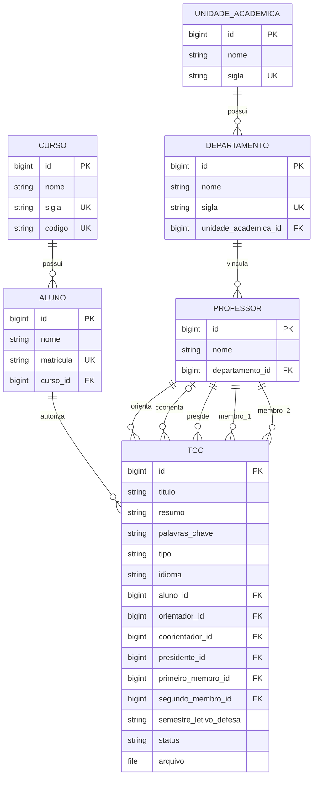

# Documentação técnica do backend — Sistema de Gestão de TCCs

> **Objetivo deste documento:** servir como referência para planejar e implementar o frontend em TypeScript, mantendo a integração fiel à API fornecida pelo professor.
>
> **Fontes analisadas:** `README.md`, `core/models.py`, `core/serializers.py`, `core/views.py`, `core/urls.py`, `core/admin.py`, `core/migrations/0001_initial.py`, `tcc_project/urls.py`, `tcc_project/settings.py`, `requirements.txt`, `core/tests.py` e `load.py`, além do enunciado do trabalho prático.
>
> **Escopo:** descrição do código existente no ZIP. Recomendações de telas e observações para o frontend estão identificadas como planejamento/inferência, não como funcionalidades já implementadas no backend.

---

## 1. Visão geral

O projeto é uma API REST para gestão de Trabalhos de Conclusão de Curso (TCC), alunos, professores e estruturas acadêmicas. Foi desenvolvido com **Django 6.0.3** e **Django REST Framework 3.16.1**, usando SQLite como banco configurado.

O backend disponibiliza operações CRUD para seis recursos principais:

1. Unidades Acadêmicas;
2. Departamentos;
3. Cursos;
4. Alunos;
5. Professores;
6. TCCs.

Também disponibiliza um endpoint agregado de estatísticas para o dashboard.

O README do backend informa que o frontend deverá contemplar listagem e busca de entidades, cadastro de TCC, alteração de status, upload de PDF e exibição de link para o arquivo. Também recomenda um dashboard de estatísticas. O README declara que **não é necessário implementar login ou controle de permissões**.

## 2. Estrutura de diretórios

```text
projeto-gestao-tccs-main/
├── core/
│   ├── migrations/
│   │   └── 0001_initial.py      # criação inicial das tabelas e relações
│   ├── __init__.py
│   ├── admin.py                 # configuração do Django Admin
│   ├── apps.py
│   ├── models.py                # entidades, campos, choices e relações
│   ├── serializers.py           # conversão dos modelos para/de JSON
│   ├── tests.py                 # sem testes implementados
│   ├── urls.py                  # rotas da API via DefaultRouter
│   └── views.py                 # CRUD e endpoint de estatísticas
├── tcc_project/
│   ├── __init__.py
│   ├── asgi.py
│   ├── settings.py              # configurações Django, DRF, CORS, banco e mídia
│   ├── urls.py                  # prefixos /admin/ e /api/
│   └── wsgi.py
├── load.py                      # carga de dados fictícios/de demonstração
├── manage.py
├── requirements.txt
├── README.md
└── LICENSE
```

### Responsabilidade dos arquivos mais importantes

| Arquivo | Responsabilidade |
|---|---|
| `core/models.py` | Define as seis entidades, seus campos, opções e chaves estrangeiras. É a principal referência do modelo de dados. |
| `core/serializers.py` | Usa `ModelSerializer` e expõe todos os campos de cada modelo (`fields = '__all__'`). No TCC, adiciona três campos de apresentação somente leitura. |
| `core/views.py` | Define `ModelViewSet` para CRUD e a ação `estatisticas` do TCC. Configura busca em alunos, professores e TCCs. |
| `core/urls.py` | Registra os seis ViewSets em um `DefaultRouter`. |
| `tcc_project/urls.py` | Inclui a API em `/api/`, o admin em `/admin/` e serve arquivos de mídia em desenvolvimento. |
| `tcc_project/settings.py` | Configura SQLite, CORS aberto, idioma `pt-BR`, fuso `America/Sao_Paulo` e diretório de mídia. |
| `load.py` | Apaga os dados existentes e popula novamente a base com dados de exemplo. **Não executar sobre uma base que contenha dados que devam ser preservados.** |
| `core/admin.py` | Configura colunas, filtros e busca para administração pelo Django Admin. Não representa telas do frontend. |
| `core/migrations/0001_initial.py` | Registra a estrutura inicial das tabelas e relações, confirmando os modelos. |
| `core/tests.py` | Contém apenas o esqueleto de testes do Django; não há testes automatizados de API implementados. |

## 3. Modelo de dados: entidades

Todos os modelos usam a chave primária `id`, criada automaticamente pelo Django (`BigAutoField`). Os relacionamentos são enviados pela API como identificadores de registros relacionados, pois os serializers são `ModelSerializer` sem expansão aninhada.

### 3.1 Unidade Acadêmica (`UnidadeAcademica`)

Representa uma unidade institucional, como uma escola, faculdade ou instituto.

| Campo | Tipo / restrição | Descrição |
|---|---|---|
| `id` | inteiro, PK automática | Identificador. |
| `nome` | texto, máximo 255 caracteres | Nome completo da unidade. |
| `sigla` | texto, máximo 10, único | Sigla institucional. |

**Relacionamentos:** uma Unidade Acadêmica possui vários Departamentos. A FK está em `Departamento.unidade_academica`, com `related_name='departamentos'`.

**Exclusão:** `CASCADE`; excluir a unidade exclui seus departamentos e, em cadeia, os professores desses departamentos e os TCCs relacionados a esses professores.

**Uso no frontend:** listagem/detalhe e seleção como referência para navegar até departamentos. O backend não fornece um endpoint específico de departamentos filtrados por unidade.

### 3.2 Departamento (`Departamento`)

Representa um departamento vinculado a uma Unidade Acadêmica.

| Campo | Tipo / restrição | Descrição |
|---|---|---|
| `id` | inteiro, PK automática | Identificador. |
| `nome` | texto, máximo 255 caracteres | Nome do departamento. |
| `sigla` | texto, máximo 10, único | Sigla do departamento. |
| `unidade_academica` | FK obrigatória para `UnidadeAcademica` | Unidade à qual pertence. |

**Relacionamentos:** cada Departamento pertence a uma Unidade Acadêmica e pode possuir vários Professores (`Professor.departamento`, `related_name='professores'`).

**Exclusão:** `CASCADE`; excluir o departamento exclui seus professores e, por consequência, TCCs que dependam desses professores nas FKs obrigatórias.

### 3.3 Curso (`Curso`)

Representa um curso acadêmico.

| Campo | Tipo / restrição | Descrição |
|---|---|---|
| `id` | inteiro, PK automática | Identificador. |
| `nome` | texto, máximo 255 caracteres | Nome do curso. |
| `sigla` | texto, máximo 10, único | Sigla do curso. |
| `codigo` | texto, máximo 50, único | Código institucional do curso. |

**Relacionamentos:** um Curso pode possuir vários Alunos (`Aluno.curso`, `related_name='alunos'`).

**Observação importante:** no modelo atual, Curso **não possui FK para Departamento nem para Unidade Acadêmica**. Embora possa parecer natural estabelecer essa associação na interface, ela não existe no backend fornecido e não deve ser presumida.

**Exclusão:** `CASCADE`; excluir um curso exclui seus alunos e, em cadeia, os TCCs desses alunos.

### 3.4 Aluno (`Aluno`)

Representa o estudante responsável por um TCC.

| Campo | Tipo / restrição | Descrição |
|---|---|---|
| `id` | inteiro, PK automática | Identificador. |
| `nome` | texto, máximo 255 caracteres | Nome do aluno. |
| `matricula` | texto, máximo 50, único | Matrícula acadêmica. |
| `curso` | FK obrigatória para `Curso` | Curso ao qual o aluno está vinculado. |

**Relacionamentos:** cada Aluno pertence a um Curso e pode possuir vários TCCs (`TCC.aluno`, `related_name='tccs'`).

**Busca:** o endpoint permite busca por `nome` e `matricula` usando o parâmetro `search` do DRF.

**Exclusão:** `CASCADE`; excluir o aluno exclui seus TCCs.

### 3.5 Professor (`Professor`)

Representa um docente que pode participar de diferentes funções em um TCC.

| Campo | Tipo / restrição | Descrição |
|---|---|---|
| `id` | inteiro, PK automática | Identificador. |
| `nome` | texto, máximo 255 caracteres | Nome do professor. |
| `departamento` | FK obrigatória para `Departamento` | Departamento ao qual pertence. |

**Relacionamentos:** cada Professor pertence a um Departamento e pode estar associado a TCCs em cinco papéis distintos:

- orientador (`TCC.orientador`, `related_name='tccs_orientados'`);
- coorientador (`TCC.coorientador`, `related_name='tccs_coorientados'`);
- presidente da banca (`TCC.presidente`, `related_name='tccs_presididos'`);
- primeiro membro da banca (`TCC.primeiro_membro`, `related_name='tccs_membro1'`);
- segundo membro da banca (`TCC.segundo_membro`, `related_name='tccs_membro2'`).

**Busca:** permite busca por `nome` usando `?search=`.

**Exclusão:** excluir o professor exclui TCCs em que ele ocupa qualquer um dos papéis obrigatórios (`orientador`, `presidente`, `primeiro_membro`, `segundo_membro`), por causa de `CASCADE`. Se for apenas coorientador, a referência do TCC é definida como nula (`SET_NULL`).

### 3.6 TCC (`TCC`)

É a entidade central do sistema. Armazena os dados acadêmicos do trabalho, seus participantes, status, semestre de defesa e arquivo.

| Campo | Tipo / restrição | Descrição |
|---|---|---|
| `id` | inteiro, PK automática | Identificador. |
| `titulo` | texto, máximo 255 caracteres | Título do trabalho. |
| `resumo` | texto longo | Resumo do TCC. |
| `palavras_chave` | texto, máximo 255 caracteres | Palavras-chave em um único campo textual. |
| `tipo` | texto, máximo 20, choices | Tipo do trabalho (ver opções abaixo). |
| `idioma` | texto, máximo 2, choices | Idioma do trabalho. |
| `aluno` | FK obrigatória para `Aluno` | Autor/aluno responsável. |
| `orientador` | FK obrigatória para `Professor` | Professor orientador. |
| `coorientador` | FK opcional para `Professor`, aceita nulo | Professor coorientador, quando houver. |
| `presidente` | FK obrigatória para `Professor` | Presidente da banca. |
| `primeiro_membro` | FK obrigatória para `Professor` | Primeiro membro da banca. |
| `segundo_membro` | FK obrigatória para `Professor` | Segundo membro da banca. |
| `semestre_letivo_defesa` | texto, máximo 10, opcional, choices | Semestre letivo previsto/associado à defesa. |
| `status` | texto de 1 caractere, choices, padrão `'0'` | Situação atual do TCC. |
| `arquivo` | arquivo, opcional, `upload_to='tccs/'` | Arquivo do trabalho; o README orienta o envio de PDF. |

#### Opções de `tipo`

| Valor enviado à API | Rótulo para exibição |
|---|---|
| `MONOGRAFIA` | Monografia |
| `RELATORIO_ESTAGIO` | Relatório de Estágio |
| `RELATORIO_TECNICO` | Relatório Técnico |
| `ARTIGO` | Artigo |

#### Opções de `idioma`

| Valor enviado à API | Rótulo para exibição |
|---|---|
| `PT` | Português |
| `EN` | Inglês |

#### Opções de `status`

| Valor enviado à API | Rótulo para exibição |
|---|---|
| `'0'` | Em Elaboração |
| `'1'` | Enviado |
| `'2'` | Aprovado |
| `'3'` | Reprovado |

O campo é uma string de um caractere, não um número inteiro. No TypeScript, é recomendável tipá-lo como união de strings (`'0' | '1' | '2' | '3'`) para evitar incompatibilidade no envio.

#### Opções de `semestre_letivo_defesa`

O modelo aceita os seguintes valores: `2020/1`, `2020/2`, `2021/1`, `2021/2`, `2022/1`, `2022/2`, `2023/1`, `2023/2`, `2024/1`, `2024/2`, `2025/1`, `2025/2` e `2026/1`. O campo é opcional e aceita nulo/vazio. A lista está codificada no modelo; não há endpoint próprio para consultar opções de semestre.

#### Campos adicionais de leitura

O `TCCSerializer` expõe, além dos campos do modelo:

- `status_display`: rótulo legível do status;
- `tipo_display`: rótulo legível do tipo;
- `idioma_display`: rótulo legível do idioma.

Esses três campos são somente leitura. Para criar/editar, enviar os valores codificados (`status`, `tipo`, `idioma`), não os campos `*_display`.

## 4. Relacionamentos entre entidades

### 4.1 Diagrama ER simplificado



**Leitura do diagrama:** os papéis de professor são relações diferentes com a mesma tabela `Professor`. O coorientador é opcional; os outros quatro papéis docentes do TCC são obrigatórios. A tabela `Curso` não se conecta diretamente a `Departamento` ou `UnidadeAcademica` no modelo atual.

### 4.2 Regras de exclusão relevantes para a interface

As FKs usam `on_delete` com os seguintes comportamentos:

| Relação | Comportamento |
|---|---|
| Departamento → Unidade Acadêmica | `CASCADE`: ao excluir a unidade, departamentos são excluídos. |
| Professor → Departamento | `CASCADE`: ao excluir o departamento, professores são excluídos. |
| Aluno → Curso | `CASCADE`: ao excluir o curso, alunos são excluídos. |
| TCC → Aluno | `CASCADE`: ao excluir o aluno, seus TCCs são excluídos. |
| TCC → Orientador | `CASCADE` |
| TCC → Presidente | `CASCADE` |
| TCC → Primeiro membro | `CASCADE` |
| TCC → Segundo membro | `CASCADE` |
| TCC → Coorientador | `SET_NULL`: ao excluir o coorientador, o TCC permanece sem coorientador. |

**Implicação para UX:** ações de exclusão em unidades, departamentos, cursos, alunos e professores podem remover registros dependentes. A interface deve pedir confirmação clara e, idealmente, avisar sobre o efeito em cascata. O backend não implementa uma tela ou confirmação especial para isso.

## 5. API REST: rotas e operações

A raiz da API é `/api/`. O `DefaultRouter` registra os ViewSets com barra final.

| Recurso | Endpoint | Busca configurada |
|---|---|---|
| Unidades Acadêmicas | `/api/unidades-academicas/` | Não |
| Departamentos | `/api/departamentos/` | Não |
| Cursos | `/api/cursos/` | Não |
| Alunos | `/api/alunos/` | `nome`, `matricula` |
| Professores | `/api/professores/` | `nome` |
| TCCs | `/api/tccs/` | `titulo`, `resumo` |
| Estatísticas | `/api/tccs/estatisticas/` | Não se aplica; somente GET |

### 5.1 Operações CRUD

Como os seis recursos usam `ModelViewSet`, cada endpoint de recurso disponibiliza as operações padrão:

| Método HTTP | Rota | Operação |
|---|---|---|
| `GET` | `/recurso/` | Lista registros. |
| `POST` | `/recurso/` | Cria registro. |
| `GET` | `/recurso/{id}/` | Consulta um registro. |
| `PUT` | `/recurso/{id}/` | Atualiza o registro completo. |
| `PATCH` | `/recurso/{id}/` | Atualiza parcialmente o registro. |
| `DELETE` | `/recurso/{id}/` | Exclui o registro. |

Para alterar somente o status de um TCC, o frontend pode usar `PATCH /api/tccs/{id}/` enviando, por exemplo, `{"status":"2"}`. Não existe uma ação/rota exclusiva de mudança de status no código; trata-se do PATCH padrão do ViewSet.

### 5.2 Busca

O backend usa `filters.SearchFilter` apenas em Aluno, Professor e TCC:

- `/api/alunos/?search=texto` pesquisa em `nome` e `matricula`;
- `/api/professores/?search=texto` pesquisa em `nome`;
- `/api/tccs/?search=texto` pesquisa em `titulo` e `resumo`.

Não há `SearchFilter` configurado para Unidade Acadêmica, Departamento ou Curso. Também não há filtros por curso, departamento, unidade, status, tipo, idioma ou semestre explicitamente configurados nas views. Se o frontend precisar desses filtros, será necessário filtrar localmente os dados carregados ou combinar buscas/solicitar evolução da API; não se deve presumir que parâmetros adicionais já funcionem no servidor.

### 5.3 Formato de relacionamentos nos requests

Como os serializers são `ModelSerializer` com `fields = '__all__'` e não declaram serializers aninhados, os relacionamentos devem ser enviados pelos IDs das entidades relacionadas. Exemplo ilustrativo de parte de um payload de TCC:

```json
{
  "aluno": 12,
  "orientador": 4,
  "coorientador": null,
  "presidente": 7,
  "primeiro_membro": 8,
  "segundo_membro": 9
}
```

Os números são apenas ilustrativos. O frontend deve obter os IDs reais pelos endpoints e não assumir valores fixos. Nas respostas, os campos de FK também são IDs; para mostrar nomes relacionados, o frontend precisará manter/carregar os catálogos correspondentes e resolver os IDs.

### 5.4 Paginação e ordenação

Não há configuração explícita de paginação, ordenação ou filtros globais nas views/settings analisados. Não planejar a interface contando com paginação de servidor ou ordenação por query string sem antes testar a API em execução.

## 6. Upload e acesso ao PDF

O modelo `TCC` possui `arquivo`, um `FileField` opcional com `upload_to='tccs/'`. O README especifica que o upload deve ser feito como `multipart/form-data`, e recomenda `FormData` no frontend.

### Regras práticas para o frontend

1. Usar `FormData` para criar/atualizar um TCC quando houver arquivo.
2. Anexar o arquivo na chave `arquivo`.
3. Não definir manualmente o cabeçalho `Content-Type` ao usar `fetch`/cliente HTTP com `FormData`; o navegador precisa gerar o `boundary` do multipart.
4. Para uma edição sem troca de arquivo, testar o comportamento de `PATCH` sem enviar `arquivo`; não enviar `null` inadvertidamente se a intenção for preservar o PDF.
5. Exibir o link do arquivo quando o campo `arquivo` vier preenchido na resposta.

O projeto configura `MEDIA_URL = '/media/'` e `MEDIA_ROOT = <raiz>/media`. Em `DEBUG=True`, `tcc_project/urls.py` adiciona o serviço de arquivos estáticos de mídia. Assim, durante o desenvolvimento, os arquivos tendem a ser acessíveis por uma URL sob `/media/`, mas o frontend deve usar a URL efetivamente retornada pelo serializer e/ou a origem configurada para a API. A configuração analisada não inclui estratégia de armazenamento/servidor de mídia para produção.

**Atenção:** o modelo aceita qualquer arquivo no nível mostrado; a exigência de PDF aparece no README como requisito funcional para o frontend, mas não foi encontrado validador de extensão ou MIME no serializer/model/view. Portanto, a validação de PDF deve ser feita na interface e, idealmente, também no backend caso se deseje garantir a regra no servidor.

## 7. Endpoint de estatísticas (Dashboard)

Rota: `GET /api/tccs/estatisticas/`.

A ação `estatisticas` agrega os registros de TCC e retorna um objeto com os seguintes campos:

| Campo da resposta | Conteúdo |
|---|---|
| `total_geral` | Quantidade total de TCCs. |
| `por_status` | Quantidade agrupada por status, usando os rótulos legíveis. |
| `por_tipo` | Quantidade agrupada por tipo, usando os rótulos legíveis. |
| `por_idioma` | Quantidade agrupada por idioma, usando os rótulos legíveis. |
| `por_semestre` | Quantidade agrupada por semestre de defesa; registros sem semestre são omitidos. |
| `por_orientador` | Quantidade por nome de orientador. |
| `por_coorientador` | Quantidade por nome de coorientador; TCCs sem coorientador são excluídos dessa agregação. |
| `por_curso` | Quantidade por nome do curso do aluno. |
| `por_departamento` | Quantidade por nome do departamento do orientador. |
| `por_unidade_academica` | Quantidade por nome da unidade acadêmica do departamento do orientador. |

Exemplo de estrutura (valores ilustrativos):

```json
{
  "total_geral": 10,
  "por_status": {
    "Aprovado": 3,
    "Em Elaboração": 2,
    "Enviado": 4,
    "Reprovado": 1
  },
  "por_tipo": {"Monografia": 5, "Artigo": 5},
  "por_idioma": {"Português": 8, "Inglês": 2},
  "por_semestre": {"2025/1": 6, "2025/2": 4},
  "por_orientador": {"Nome do Professor": 2},
  "por_coorientador": {"Nome do Professor": 1},
  "por_curso": {"Nome do Curso": 4},
  "por_departamento": {"Nome do Departamento": 4},
  "por_unidade_academica": {"Nome da Unidade": 4}
}
```

O endpoint é adequado para cards de indicadores e gráficos (status, tipo, idioma, semestre, curso, departamento, unidade e orientação). A resposta não inclui séries temporais nem dados detalhados de cada TCC.

## 8. Configurações e aspectos de integração

- **Origem local indicada no README:** `http://127.0.0.1:8000`.
- **Prefixo da API:** `/api/`.
- **CORS:** `CORS_ALLOW_ALL_ORIGINS = True`, permitindo chamadas cross-origin no ambiente configurado.
- **Banco:** SQLite (`db.sqlite3`).
- **Idioma:** `pt-BR`.
- **Fuso:** `America/Sao_Paulo`.
- **Mídia:** `/media/`, armazenada no diretório `media`.
- **Autenticação:** não há autenticação exigida/configurada nas views; o README declara que login e controle de permissão não são necessários para o trabalho.
- **Admin:** `/admin/`, separado da API; não é necessário para o frontend solicitado.

O `settings.py` contém `DEBUG = True`, `ALLOWED_HOSTS = ['*']` e uma chave secreta de desenvolvimento. Essas opções são próprias do ambiente didático e não devem ser tratadas como configuração segura de produção.

## 9. Dados de demonstração (`load.py`)

O script `load.py` cria dados iniciais para facilitar testes e demonstrações. A leitura do script mostra que ele começa apagando os registros existentes de TCC, Aluno, Professor, Curso, Departamento e Unidade Acadêmica, e então cria um conjunto de unidades, departamentos, cursos, professores, alunos e TCCs fictícios.

**Cuidado:** executar `python load.py` novamente apaga e recria os dados dessas entidades. Usar somente em base de desenvolvimento/demonstração que possa ser sobrescrita.

O arquivo de carga é uma fonte de dados de exemplo, não uma definição adicional do esquema. As regras estruturais oficiais continuam sendo os modelos e a migração.

## 10. Planejamento inicial de telas do frontend

Esta seção é uma **proposta de organização**, derivada dos recursos e requisitos encontrados. Não significa que essas telas existam no backend.

### 10.1 Estrutura de navegação sugerida

Uma aplicação com layout administrativo pode usar uma barra lateral com:

1. **Dashboard** — indicadores e gráficos consumindo `/api/tccs/estatisticas/`.
2. **TCCs** — listagem, busca, visualização de detalhes, cadastro/edição, status e PDF.
3. **Alunos** — listagem, busca por nome/matrícula e detalhes.
4. **Professores** — listagem, busca por nome e detalhes.
5. **Cursos** — listagem e detalhes.
6. **Departamentos** — listagem e detalhes, com unidade acadêmica associada.
7. **Unidades Acadêmicas** — listagem e detalhes.

### 10.2 Telas e fluxos sugeridos

| Tela/área | Principais componentes/ações | API envolvida |
|---|---|---|
| Dashboard | Cards de total; gráficos por status, tipo, idioma, semestre e curso; rankings por orientador/unidade | `GET /api/tccs/estatisticas/` |
| Listagem de TCCs | Tabela, busca por título/resumo, status, tipo, aluno, orientador, link do PDF, ações | `GET /api/tccs/`, `GET /api/alunos/`, `GET /api/professores/` |
| Cadastro/edição de TCC | Formulário com dados bibliográficos, aluno, orientador, coorientador opcional, banca, semestre, status e PDF | `POST`, `PUT` ou `PATCH /api/tccs/` |
| Detalhes do TCC | Dados completos, participantes, status e abrir/baixar PDF | `GET /api/tccs/{id}/` e catálogos relacionados |
| Alteração de status | Ação rápida ou seção no detalhe, com os quatro estados disponíveis | `PATCH /api/tccs/{id}/` |
| Alunos | Tabela, busca, detalhe e formulário CRUD se desejado | `/api/alunos/` |
| Professores | Tabela, busca, departamento e formulário CRUD se desejado | `/api/professores/` |
| Cursos | Tabela e formulário CRUD se desejado | `/api/cursos/` |
| Departamentos | Tabela, unidade associada e formulário CRUD se desejado | `/api/departamentos/`, `/api/unidades-academicas/` |
| Unidades Acadêmicas | Tabela e formulário CRUD se desejado | `/api/unidades-academicas/` |

### 10.3 Fluxo principal de cadastro de TCC

1. Carregar alunos e professores para preencher os seletores.
2. Carregar demais catálogos caso a tela também mostre filtros/contexto acadêmico.
3. Usuário preenche título, resumo, palavras-chave, tipo e idioma.
4. Seleciona aluno, orientador e os três integrantes obrigatórios da banca; coorientador é opcional.
5. Informa semestre de defesa, se aplicável, e seleciona o PDF.
6. Frontend valida campos obrigatórios, limites conhecidos e arquivo PDF.
7. Envia `multipart/form-data` para a API.
8. Atualiza a listagem/detalhe e apresenta o link do arquivo quando retornado.

### 10.4 Observações para decisões de UX

- O backend não oferece autenticação, perfis ou permissões; não planejar telas de login como requisito obrigatório.
- Não há endpoint de detalhe agregado que retorne TCC com nomes de aluno/professores. Será necessário resolver os IDs com dados de catálogo ou fazer chamadas adicionais.
- A API não expõe filtros avançados explicitamente. Filtros por status, tipo, curso e semestre podem ser implementados no frontend após carregar os registros, considerando o volume de dados.
- O TCC exige quatro referências docentes obrigatórias (orientador, presidente e dois membros), além do aluno. A interface precisa distinguir claramente os papéis para evitar selecionar a pessoa errada.
- O coorientador é opcional.
- O campo `palavras_chave` é um texto único, não uma lista estruturada. O frontend pode oferecer entrada amigável separada por vírgulas, mas deve serializar para string.
- O status padrão no backend é `'0'` (Em Elaboração), mas a interface pode exibir explicitamente essa opção.
- O semestre de defesa é opcional e sua lista está limitada aos valores codificados no backend até `2026/1`.
- Exclusões podem provocar cascatas importantes; preferir confirmação e avisos.

## 11. Pontos de atenção / limitações observadas

Os itens abaixo são constatações do código analisado e devem ser considerados no planejamento:

1. **Curso sem vínculo institucional:** Curso não está relacionado a Departamento ou Unidade Acadêmica no modelo.
2. **Busca parcial:** busca de servidor está configurada apenas para Aluno, Professor e TCC, e somente nos campos listados.
3. **Sem filtros avançados declarados:** não há filtros por status, tipo, semestre, curso ou unidade configurados nas views.
4. **Sem serializers aninhados:** respostas de relacionamentos usam IDs, não objetos com nomes.
5. **Sem validação explícita de PDF:** o README pede PDF, mas o modelo/serializer não restringe tipo de arquivo no código analisado.
6. **Sem rota específica de status:** alteração de status usa o `PATCH` genérico do TCC.
7. **Sem testes de API:** `core/tests.py` está vazio além do esqueleto padrão.
8. **Sem configuração explícita de paginação:** não assumir paginação de servidor.
9. **Sem configuração de produção para mídia:** o serviço de mídia via `static()` está condicionado a `DEBUG`.
10. **Cascata de exclusão:** a exclusão de entidades estruturais pode apagar TCCs associados.
11. **Choices de semestre estáticas:** novas opções exigem alteração no backend.
12. **`load.py` destrutivo:** apaga os dados existentes antes de popular novamente.

## 12. Tipos TypeScript iniciais (referência para o frontend)

Os tipos abaixo são uma sugestão de espelhamento do contrato atual da API. Ajustar após validar respostas reais em execução.

```ts
export type StatusTCC = '0' | '1' | '2' | '3';
export type TipoTCC =
  | 'MONOGRAFIA'
  | 'RELATORIO_ESTAGIO'
  | 'RELATORIO_TECNICO'
  | 'ARTIGO';
export type IdiomaTCC = 'PT' | 'EN';
export type SemestreDefesa =
  | '2020/1' | '2020/2'
  | '2021/1' | '2021/2'
  | '2022/1' | '2022/2'
  | '2023/1' | '2023/2'
  | '2024/1' | '2024/2'
  | '2025/1' | '2025/2'
  | '2026/1';

export interface UnidadeAcademica {
  id: number;
  nome: string;
  sigla: string;
}

export interface Departamento {
  id: number;
  nome: string;
  sigla: string;
  unidade_academica: number;
}

export interface Curso {
  id: number;
  nome: string;
  sigla: string;
  codigo: string;
}

export interface Aluno {
  id: number;
  nome: string;
  matricula: string;
  curso: number;
}

export interface Professor {
  id: number;
  nome: string;
  departamento: number;
}

export interface TCC {
  id: number;
  titulo: string;
  resumo: string;
  palavras_chave: string;
  tipo: TipoTCC;
  tipo_display: string;
  idioma: IdiomaTCC;
  idioma_display: string;
  aluno: number;
  orientador: number;
  coorientador: number | null;
  presidente: number;
  primeiro_membro: number;
  segundo_membro: number;
  semestre_letivo_defesa: SemestreDefesa | null;
  status: StatusTCC;
  status_display: string;
  arquivo: string | null;
}
```

> Nota: os tipos representam o formato esperado pelos serializers com base nos modelos. O campo `arquivo` normalmente é representado na resposta por uma URL/valor serializado pelo DRF; confirmar o formato exato e a URL absoluta/relativa executando a API.

## 13. Sequência recomendada para iniciar o frontend

1. Executar o backend e validar os endpoints e payloads reais no navegador/API browsable ou ferramenta HTTP.
2. Criar a camada TypeScript de tipos, constantes e cliente HTTP.
3. Implementar carregamento/cache dos catálogos (alunos, professores, cursos, departamentos e unidades).
4. Implementar layout geral e navegação.
5. Implementar listagem/detalhe/cadastro/edição de TCC, incluindo multipart e link do PDF.
6. Implementar alteração de status.
7. Implementar listagens e buscas das demais entidades.
8. Implementar dashboard com os dados agregados.
9. Testar fluxos completos, validações, estados vazios/erro/carregamento e exclusões.

---

## 14. Referência ao enunciado do trabalho

O enunciado de GAC116 — Programação Web define como objetivo implementar o frontend do Sistema de Gestão de TCC utilizando tecnologia livre e integrar a aplicação à API REST em DRF já fornecida. A escolha tecnológica deve ser aprovada pelo professor e registrada pelo grupo.

Na avaliação, o documento atribui pesos a listagem/busca de entidades, cadastro de TCC, alteração de status, upload de PDF, qualidade de interface/UX, complexidade e apresentação. Isso reforça a prioridade de implementar corretamente o fluxo de TCC e a navegação entre os catálogos, além do dashboard descrito no README do backend.

